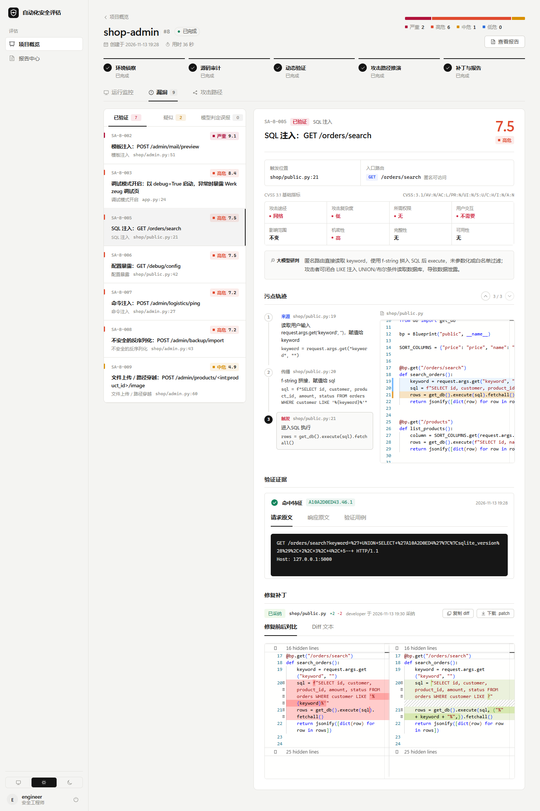
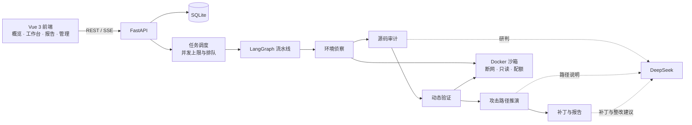

# sec-assess 自动化安全评估系统

面向 Python（Flask）源码工程的自动化安全评估系统。提交 Git 地址或源码压缩包后，系统在断网的 Docker 沙箱里依次完成环境侦察、源码审计、动态验证、攻击路径推演、补丁与报告五个阶段，输出带文件行号、污点轨迹和验证报文的漏洞证据，把已验证漏洞按获得的能力串成多步攻击路径，为每条已验证漏洞生成可 `git apply` 的修复补丁，并导出 Markdown、HTML、PDF 三种格式的评估报告。



- [项目介绍](docs/项目介绍.md)：架构、实现、效果、测试与压测结果
- [验收记录](docs/验收记录.md)：逐条核对需求、功能与成功标准，附 19 张截图

## 功能

- **两种接入方式**：公开 HTTPS Git 仓库浅克隆，或上传 zip 源码包（校验路径穿越、符号链接和大小上限）。
- **隔离沙箱**：每个评估一个容器，`--network none`、根文件系统只读、源码只读挂载、非 root、丢弃全部 capabilities，CPU、内存、进程数和总时长可配置；停止评估时容器在 1 秒内销毁。
- **依赖自动准备**：宿主机只下载预编译 wheel，容器内离线安装，整个评估过程容器不联网。
- **跨文件污点分析**：基于 `ast` 自研，覆盖 SQL 注入、命令注入、模板注入、反序列化、文件上传与路径穿越，另有越权、缺失鉴权和敏感信息规则；每条候选记录从输入到敏感函数的逐步轨迹。
- **大模型研判**：DeepSeek 判断误报、给出 CVSS 3.1 向量和理由；可利用性指标由程序按漏洞类别和路由访问前提确定，模型只判断影响。模型不可用时按类别默认向量兜底。
- **无害动态验证**：在沙箱里启动工程副本，探针只放算式或随机标记，响应出现计算结果才算命中；命中的漏洞标为已验证并保存请求、响应和重放用例，其余保持疑似且不高于中危。
- **攻击路径推演**：规则把已验证漏洞按“获得的能力满足下一步的前置条件”连成 DAG，输出多步攻击路径，大模型只写阶段说明和业务危害。
- **修复补丁**：替换漏洞所在的最内层函数，输出带 `a/`、`b/` 前缀的 unified diff，可直接 `git apply`；工作台左右对比，研发人员可采纳。
- **实时工作台**：SSE 推送阶段、日志和资源指标，五阶段进度、终端样式日志、CPU / 内存曲线，漏洞详情含 CVSS 拆解、污点时间线和证据报文。
- **报告与管理**：报告五章对应需求 2.5.8，三种格式出自同一份 Markdown；三类角色权限、沙箱与模型配置页、操作审计日志；界面支持浅色、深色和跟随系统。

## 架构



详细设计见 [docs/项目介绍.md](docs/项目介绍.md) 与 [docs/DESIGN.md](docs/DESIGN.md)。

## 快速开始

环境要求：Docker Desktop 已启动，Python 3.12 与 [uv](https://docs.astral.sh/uv/)，Node.js 与 pnpm。开发与验收在 Windows 11 + Docker Desktop（WSL2 后端）上进行，镜像构建脚本为 PowerShell。

1. 配置环境变量。复制模板后填写 `JWT_SECRET`、`SEED_PASSWORD` 和大模型配置；`.env` 只留在本机。

   ```bash
   cp .env.example .env
   ```

2. 构建沙箱镜像（需要联网拉取基础镜像，PowerShell 7，项目根目录）：

   ```powershell
   ./sandbox-images/build.ps1
   ```

3. 启动后端（监听 `127.0.0.1:8010`，首次启动建库并创建 `engineer`、`developer`、`admin` 三个账号，初始密码为 `SEED_PASSWORD`）：

   ```bash
   uv run --directory backend python -m app.main
   ```

4. 启动前端（`http://127.0.0.1:5173`，`/api` 代理到后端）：

   ```bash
   pnpm --dir frontend install
   pnpm --dir frontend dev
   ```

5. 用 `engineer` 登录，在项目概览点“新建评估”，上传 `targets/shop-admin` 打成的 zip，即可看到完整的五阶段评估。PDF 导出优先使用 Playwright 自带的 Chromium，未安装时改用本机的 Edge 或 Chrome。

## 测试与压测

```bash
# 单元测试（不需要 Docker）
uv run --directory backend pytest -m "not docker and not network and not llm"

# 集成测试：需要 Docker 与沙箱镜像，部分用例访问 PyPI 或调用大模型
uv run --directory backend pytest -m "docker or network or llm"

# 评估压测：自动启动一个独立后端实例，按并发上限 1/2/4 成批提交两个靶场
uv run --directory backend python scripts/load_test.py --levels 1,2,4 --tasks 8 --llm off
```

测试共 235 条。关闭大模型时，并发 4 每分钟完成 22 个靶场评估；开启大模型后，耗时主要花在模型接口上。压测方法与完整数据见 [docs/项目介绍.md](docs/项目介绍.md#5-测试与压测)。

## 目录

```
backend/          FastAPI 后端：api、core、project、pipeline、sandbox、taint、verify、chain、patch、report
backend/scripts/  评估压测脚本
backend/tests/    单元测试与集成测试
frontend/         Vue 3 + Vite + TypeScript + Element Plus 前端
sandbox-images/   沙箱镜像 Dockerfile 与容器内探针执行脚本
targets/          两个教学靶场：shop-admin（电商后台）、user-center（用户中心）
docs/             需求、规格、设计、任务清单、验收记录、项目介绍与截图
```

## 文档

| 文档 | 内容 |
| --- | --- |
| [项目介绍](docs/项目介绍.md) | 架构、实现、效果、测试与压测结果 |
| [需求说明](docs/需求说明.md) | 原始需求（项目实战 2.5） |
| [SPEC](docs/SPEC.md) | 规格、验收标准、假设与决策记录 D-001～D-031 |
| [DESIGN](docs/DESIGN.md) | 技术方案：沙箱、流水线各阶段、数据模型、前端 |
| [TASKS](docs/TASKS.md) | 任务清单 |
| [验收记录](docs/验收记录.md) | 逐条核对需求、功能与成功标准，附 19 张截图 |

## 安全边界

动态验证只在本系统创建的断网容器内、针对容器里的工程副本进行，系统不提供对任意外部地址发起探测的功能；探针只判定漏洞能否触发，不获取交互式 shell、不植入持久化、不横向移动。`targets/` 下的两个靶场故意包含漏洞，只用于教学演示，不要部署到任何可访问的环境。
