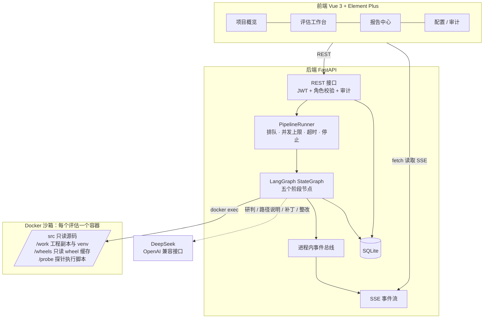
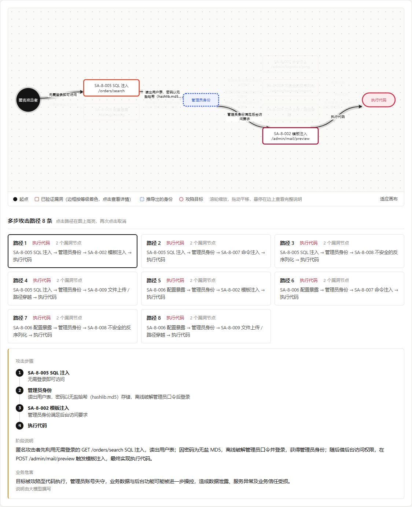

# 自动化安全评估系统 项目介绍

本文介绍系统的架构、各模块的实现方式、在两个靶场上的评估效果，以及自动化测试和评估压测的结果。需求原文见 [需求说明.md](需求说明.md)，规格与决策记录见 [SPEC.md](SPEC.md)（文中 D-0xx、FR-0xx、SC-0xx 均指其中编号），实现细节见 [DESIGN.md](DESIGN.md)，逐条验收见 [验收记录.md](验收记录.md)。

## 1. 概述

系统面向 Python（Flask）源码工程。安全工程师提交 Git 地址或 zip 源码包后，后端为这次评估创建一个断网的 Docker 容器，按固定顺序执行五个阶段：

| 阶段 | 做什么 | 产出 |
| --- | --- | --- |
| 环境侦察 recon | 识别技术栈与依赖清单，提取 Flask 路由表、访问前提、注册登录接口、密码存储方式，准备运行依赖 | 侦察事实、依赖准备结果 |
| 源码审计 code_audit | 跨文件污点分析、越权与敏感信息规则产出候选，大模型研判误报并给出 CVSS 向量 | 疑似漏洞、污点轨迹 |
| 动态验证 poc_verify | 在沙箱里启动工程副本，发送无害探针，按命中特征判定 | 已验证 / 疑似状态、请求响应证据 |
| 攻击路径推演 exploit_chain | 按“获得的能力满足下一步前置条件”把已验证漏洞连成 DAG | 攻击路径图、多步路径与说明 |
| 补丁与报告 report_gen | 为已验证漏洞生成补丁，计算评分与整改优先级 | unified diff 补丁、五章评估报告 |

使用者分三类角色：安全工程师新建与停止评估、导出报告；研发人员查看结果、采纳补丁；系统管理员管理沙箱与模型配置、查看审计日志。

设计上的核心取舍是**结论由确定性规则产出，大模型只做判断和写作**（D-002）：候选漏洞来自污点引擎与规则，“已验证”来自探针的命中特征，攻击路径由规则连边；大模型负责误报研判、CVSS 影响指标、补丁代码和报告文字。模型不可用或被关闭时，每个环节都有规则兜底，评估照常完成。

## 2. 架构



一次评估的数据流：

1. `POST /api/tasks` 接收 Git 地址或 zip，zip 在上传时同步校验并解压，建档后任务为 `created`。
2. `PipelineRunner.pump()` 在并发上限内按创建顺序取出排队任务，置为 `running`，把当时的运行参数快照写入 `task.quota`，为每个任务启动一个 `asyncio` 协程执行 LangGraph 图。
3. 每个阶段节点先检查停止信号，再写“阶段开始”日志并推送 `stage` 事件，执行对应 Agent，最后写“阶段结束，用时 N 秒”。
4. Agent 通过 `docker exec` 在容器里执行命令；资源采样线程读取 Docker stats 流，经事件总线推送 `metrics` 事件。
5. 任务结束、失败、超时或被停止时，`_finish` 销毁容器、封顶疑似漏洞的等级、写最终状态，然后再次 `pump()` 拉起下一个排队任务。

| 层 | 选型 |
| --- | --- |
| 后端 | Python 3.12、FastAPI、SQLAlchemy 2（async）+ aiosqlite、uv |
| 编排 | LangGraph StateGraph |
| 沙箱 | Docker SDK for Python，自建镜像 `sec-assess/sandbox-python:3.12` |
| 分析 | 标准库 `ast` 自研污点引擎，CVSS 3.1 公式自实现 |
| 大模型 | DeepSeek，`openai` SDK 的 OpenAI 兼容接口 |
| 报告 | Jinja2 → Markdown → markdown-it-py → HTML → Playwright 打印 PDF |
| 前端 | Vue 3、Vite、TypeScript、Element Plus、Pinia、Monaco Editor、AntV G6、ECharts |

代码规模：后端应用约 8700 行，测试约 4550 行，前端约 7200 行。

## 3. 实现

### 3.1 调度与流水线

`PipelineRunner` 维护一个 `task_id → asyncio.Task` 的运行表。`pump()` 持有一把 `asyncio.Lock`，读出配置的 `max_concurrent`，用空闲槽位数从库里按 `id` 取 `created` 任务，避免并发提交时超发。任务协程用 `asyncio.timeout(task_timeout_min × 60)` 包住 `graph.ainvoke()`，超时记为 `failed`。

停止分两种情况：排队中的任务直接用带 `status = created` 条件的 UPDATE 置为 `stopped`；运行中的任务先设置停止事件、`docker kill` 并删除容器和任务卷，再取消协程。阶段之间和每个验证用例之间检查停止事件，容器已删除导致的后续调用失败按“已停止”收尾。验收实测停止后 0.31～0.33 秒容器消失（SC-006）。

后端启动时只清理本实例（由数据目录哈希得出的实例标识）留下的容器和卷，并把遗留的 `running` 任务置为 `failed`，开发后端与测试、压测实例可以共用一个 Docker。

### 3.2 沙箱与依赖准备

每个评估一个容器：源码只读挂载到 `/src`，需要运行工程时复制到任务专属 Docker 卷 `/work`；根文件系统只读，`/tmp` 为 64 MB tmpfs；`--network none`、丢弃全部 capabilities、`no-new-privileges`、以 10001 用户运行；CPU、内存（不可换出）、进程数取自配置。集成测试在容器里尝试外联、写 `/src` 和提权，三者都必须失败（SC-007）。

容器不联网，依赖由宿主机准备（D-012）：在任务容器里读 glibc 版本得到 manylinux 平台标签，宿主机按 `requirements.txt` / `pyproject.toml` 执行 `pip download --only-binary=:all:`，只取预编译 wheel、不执行任何构建脚本；wheel 缓存在 `data/wheelhouse/` 并只读挂进容器，由容器内 `pip install --no-index` 离线安装。拿不到 wheel 的包改用镜像预装版本，仍缺失则跳过动态验证。用户中心靶场依赖的 PyJWT 不在预装镜像里，用来验证这条路径（SC-010）。

### 3.3 环境侦察

确定性解析 Python、Java、Node.js 的依赖清单并统计代码行数；用 AST 提取 Flask 路由表（URL、方法、处理函数、装饰器），并记录后续阶段要用的事实：`app.run` 或 `create_app` 启动方式与端口、每条路由的访问前提（无装饰器为匿名、登录装饰器为普通用户、管理员装饰器为管理员）、注册与登录接口的字段名、用户表的密码存储方式（明文 / 无盐哈希 / 加盐哈希）、会话是否为 Flask 签名 Cookie。测试代码不参与分析（D-020）。

### 3.4 污点分析与规则

污点引擎从每个路由处理函数出发，把 `request.args / form / json / files / headers / cookies` 和 URL 参数标为污点（`int`、`float`、`uuid` 转换器的参数除外），沿赋值、`+` / f-string / `%` / `str.format` 拼接、函数参数和返回值传播，跨文件调用最多追 3 层；到达 SQL 执行、`subprocess`、`pickle.loads`、文件路径操作、`render_template_string` 等 Sink 且途中没有经过对应净化函数时，产出候选并记录每一步的文件、行号、变量和代码片段。`x in 白名单` 为真的分支、以及不在白名单时提前返回之后，`x` 视为已净化，所以“按白名单拼接排序列名”这类诱饵写法不会报出。

污点之外还有两组规则：鉴权规则检查需要登录、带资源 ID 参数、却没有按当前用户过滤的路由（越权），以及匿名可访问却查询用户数据的路由（缺失鉴权）；敏感信息规则检查硬编码密钥、调试开关、暴露的配置接口和明文 / 无盐哈希密码存储。

### 3.5 大模型研判与 CVSS

审计 Agent 把每条候选所在函数和轨迹涉及的代码片段（单次不超过 16000 字符）发给模型，要求返回 JSON：是否误报、类别、CVSS 3.1 向量和理由，默认 4 路并发。为了让分数在多次评估之间稳定，程序只采纳模型对 S、C、I、A 的判断：AV、AC、UI 取漏洞类别的默认值，PR 按路由访问前提（匿名 N、普通用户 L、管理员 H）确定，再按 3.1 基础分公式自己计算分数（D-015、D-029）。模型判为误报的放入“模型判定误报”分组，不计入评分；模型不可用时按类别默认向量计分，理由标注“未经模型研判”。

### 3.6 动态验证

容器没有网络，宿主机连不上容器端口，所以探针执行脚本挂在容器里：宿主机通过 `docker exec` 下发用例 JSON，脚本向容器内 `127.0.0.1` 发请求，返回请求与响应原文（D-014）。每类漏洞一个用例模板，探针只放算式或随机名，响应里出现计算结果才算命中，以排除输入被原样回显的误判：SQL 注入用 UNION 拼接 `sqlite_version()` 和随机标记，命令注入算 `$((a+b))`，模板注入算 `{{a*b}}`，反序列化与无回显的命令注入在 `/tmp` 创建随机名文件后检查是否存在，越权用自动注册的账号 A 读取账号 B 写入的随机标记。管理接口的用例先从源码的种子账号列表取得管理员会话（D-022）。

命中的漏洞改为“已验证”并保存请求、响应、命中特征和重放用例；其余保持“疑似”，阶段结束时严重与高危一律降为中危（D-029）。

### 3.7 攻击路径推演

每类漏洞登记获得的能力：SQL 注入读数据库、配置暴露读应用密钥、越权读他人数据、文件上传写任意文件、命令 / 模板注入与反序列化执行代码。能力之间的推导依据侦察事实，例如“读数据库且密码为无盐哈希 → 管理员身份”“读应用密钥且会话是 Flask 签名 Cookie → 伪造管理员会话”“写文件落在工程目录 → 执行代码”。图从“匿名攻击者”出发，漏洞的入口取所在路由的访问前提，身份只升不降，所以图中没有环；只保留既能从起点到达又能到达终点的节点，经过至少两个漏洞的路径作为多步攻击路径输出。大模型只为每条路径写阶段说明和业务危害，不参与连边（D-008）。

### 3.8 补丁

补丁范围是漏洞行所在的最内层函数（含装饰器），不在函数内时取所在的那条模块级语句。模型拿到漏洞信息、污点轨迹、文件的导入与其他函数签名、工程自带的装饰器源码，输出修复后的完整函数和需要新增的导入；程序原样替换、把导入插到导入块末尾，再用 `difflib` 生成带 `a/`、`b/` 前缀的 unified diff（D-009、D-026）。输出必须仍是同名函数的完整定义、替换后整个文件能通过语法解析，不满足时带着原因重试一次。验收时两个靶场的 9 个补丁在原工程副本上 `git apply --check` 全部通过。

### 3.9 报告

评分为 100 减去扣分：已验证漏洞按严重 25、高危 15、中危 8、低危 3 扣分，疑似减半，模型判定误报不扣。整改优先级 P1～P4 由 CVSS 和是否位于执行代码路径决定。报告五章对应需求 2.5.8，用 Jinja2 渲染成 Markdown，转换成 HTML，PDF 打印该 HTML，三种格式内容一致（D-025）；漏洞类型占比饼图由服务端生成 SVG 嵌入。转换时禁用原始 HTML，被评估工程的代码和报文只以转义文本出现，打印 PDF 时禁用脚本并拦截全部网络请求。

### 3.10 实时推送

进程内事件总线为每个订阅者建一个容量 500 的 `asyncio.Queue`，流水线在事件循环里直接投递，资源采样线程用 `call_soon_threadsafe` 投递；队列满时丢弃最旧的一条，保证最新状态能送达。SSE 接口订阅后持续输出 `stage`、`log`、`metrics`、`status` 四类事件，15 秒没有事件时发一条心跳注释；打开工作台前已产生的日志由前端调用 `/logs?after=` 补齐。前端用 `fetch` 读取事件流而不是 `EventSource`，以便携带 `Authorization` 头，令牌不出现在 URL 里。

### 3.11 前端与权限

左侧导航栏布局，支持浅色、深色和跟随系统三种主题，Element Plus、Monaco、ECharts 和 G6 的配色随主题切换（D-030）。项目概览给出严重与高危漏洞数、等级分布、各状态评估数和项目卡片；评估工作台顶部是状态、用时、等级分布和五阶段进度，下方分运行监控、漏洞、攻击路径三个标签页。所有接口都要求登录，受限接口按角色返回 403；登录、新建与停止评估、采纳补丁、导出报告、修改配置都写审计日志，配置修改逐项记录旧值与新值。

## 4. 效果

两个自写的教学靶场覆盖需求中的两个示例场景，下表为验收时的开发后端实测（任务 #8、#9，大模型开启，并发 1）：

| 靶场 | 漏洞清单 | 结果 | 耗时 |
| --- | --- | --- | --- |
| shop-admin 电商后台 | SQL 注入、配置暴露、调试模式、命令注入、反序列化、模板注入、文件上传（预期已验证）；硬编码密钥、弱密码存储（预期疑似） | 7 条已验证、2 条疑似，与清单一致；诱饵写法无一报出；多步攻击路径 8 条；7 个补丁全部可 `git apply` | 从提交到完成 35.8 秒 |
| user-center 用户中心 | 越权、缺失鉴权（预期已验证）；硬编码密钥（预期疑似） | 2 条已验证、1 条疑似；依赖 PyJWT 自动准备；两条漏洞各自一步到达“读他人数据”，没有多步路径并在报告中说明原因 | 24 秒 |

电商靶场的 8 条多步路径都是“入口漏洞 → 管理员身份 → 后台漏洞 → 执行代码”，例如：匿名攻击者 → SQL 注入 `/orders/search` 读出用户表 → 密码为无盐 MD5，离线破解得到管理员身份 → 模板注入 `/admin/mail/preview` → 执行代码。



| 成功标准 | 实测 |
| --- | --- |
| SC-001 电商靶场 15 分钟内完成 | 35.8 秒 |
| SC-005 日志延迟 ≤ 2 秒、资源 ≤ 2 秒刷新 | 日志最大 0.313 秒；资源推送间隔中位 1.000 秒、最大 1.016 秒 |
| SC-006 停止后 5 秒内容器消失 | 0.31 秒、0.33 秒 |
| SC-008 三种格式导出 | Markdown 41 KB、HTML 53 KB、PDF 22 页 |

更多界面见 [验收记录.md](验收记录.md#截图清单) 的 19 张截图。

## 5. 测试与压测

### 5.1 自动化测试

共 235 条，2026-11-13 在本机全部运行：

| 分组 | 条数 | 依赖 | 结果 |
| --- | --- | --- | --- |
| 单元测试 `-m "not docker and not network and not llm"` | 216 | 无 | 全部通过，36.7 秒 |
| 集成测试 `-m "docker or network or llm"` | 19 | Docker 与沙箱镜像，部分访问 PyPI 或调用 DeepSeek | 全部通过，8 分 47 秒 |

单元测试覆盖接入校验、技术栈与路由提取、污点引擎（跨文件 3 层、白名单净化、类型转换器）、鉴权与敏感信息规则、CVSS 计算与锚定、研判兜底、验证用例的命中规则、攻击路径组装、补丁替换与校验、评分与报告渲染、权限矩阵、配置接口与事件总线。集成测试覆盖容器隔离自检（外联、写只读目录、提权都失败）、配额与加固参数、依赖准备、两个靶场的端到端评估、停止与超时、补丁 `git apply --check`。污点引擎的回归分两层（D-021）：每类漏洞配一段诱饵写法要求不报，再以两个靶场为整体基准按类别、文件、函数精确比对。

### 5.2 评估压测

**方法**：脚本 [backend/scripts/load_test.py](../backend/scripts/load_test.py) 启动一个独立的后端实例（临时数据目录、空闲端口，复制一份 wheel 缓存），通过配置接口设置并发上限和大模型开关，每档一次性提交 8 个评估（两个靶场各 4 个，zip 上传），超出并发上限的进入排队。评估进行期间：

- 每个任务订阅一条 SSE 事件流，记录每条日志事件的推送延迟和资源事件的到达间隔；
- 每 0.5 秒请求一轮 `GET /api/projects`、`GET /api/tasks/{id}`、`GET /api/tasks/{id}/findings`，记录响应时间；
- 每秒读一次本实例沙箱容器的 `docker stats`。

全部结束后，从接口取每个任务的时间戳、各阶段用时（日志“阶段结束：X，用时 N 秒”）和漏洞结果。主压测关闭大模型（研判、补丁和文字走规则兜底），按并发上限 1、2、4 各跑一档；另开大模型在并发 4 跑一档对照。

**环境**：Intel Core Ultra 5 225H（14 核）、31.4 GB 内存，Windows 11，Docker Desktop 29.9.3（分配 14 CPU、9.7 GB 内存）；沙箱配额为默认的 1 核、1024 MB、256 个进程；大模型为 DeepSeek，单任务研判与补丁并发 4。

**结果**（时间单位秒；“接口 p95”取三个接口中最高的一个）：

| 并发 | 大模型 | 完成 | 总耗时 | 吞吐（个/分） | 排队 p50 / 最大 | 单任务运行 p50 / p95 | 提交到完成 p50 / 最大 | 接口 p95 / 最大（ms） | 日志推送 p95 / 最大 | 资源间隔最大 | 沙箱峰值 CPU / 内存 |
| --- | --- | --- | --- | --- | --- | --- | --- | --- | --- | --- | --- |
| 1 | 关 | 8/8 | 66.5 | 7.21 | 26.0 / 59.1 | 7.8 / 9.4 | 33.9 / 66.3 | 12.7 / 128.1 | 0.003 / 0.058 | 1.012 | 94% / 76 MB |
| 2 | 关 | 8/8 | 35.2 | 13.62 | 9.3 / 27.0 | 8.2 / 9.8 | 17.7 / 35.0 | 32.6 / 114.2 | 0.004 / 0.032 | 1.024 | 190% / 104 MB |
| 4 | 关 | 8/8 | 21.7 | 22.15 | 0.03 / 12.3 | 9.7 / 12.7 | 12.7 / 21.3 | 49.9 / 103.8 | 0.014 / 0.220 | 1.037 | 322% / 222 MB |
| 4 | 开 | 8/8 | 389.4 | 1.23 | 0.02 / 102.3 | 89.9 / 286.4 | 102.7 / 388.7 | 8.5 / 99.5 | 0.004 / 0.062 | 1.028 | 118% / 84 MB |

各阶段平均用时：

| 并发 | 大模型 | 环境侦察 | 源码审计 | 动态验证 | 攻击路径推演 | 补丁与报告 |
| --- | --- | --- | --- | --- | --- | --- |
| 1 | 关 | 3.10 | 0.03 | 4.97 | 0.00 | 0.01 |
| 2 | 关 | 3.14 | 0.03 | 5.35 | 0.03 | 0.01 |
| 4 | 关 | 3.80 | 0.04 | 6.00 | 0.01 | 0.06 |
| 4 | 开 | 3.62 | 20.18 | 4.97 | 15.00 | 76.01 |

开大模型时用户中心靶场没有多步路径，攻击路径推演不调用模型；只算电商靶场，这一阶段平均 30.0 秒。

**正确性**：四档共 32 个评估全部 completed；电商靶场每次都是 9 条漏洞、7 条已验证，用户中心每次都是 3 条、2 条已验证，开不开大模型结果相同；观测到的同时运行数和沙箱容器数始终等于并发上限，没有超发；接口请求和事件流都没有出错；压测实例结束后没有遗留容器和卷。

**分析**：

- **沙箱部分随并发近似线性扩展**。关闭大模型时，一次评估的时间几乎都花在两个阶段：环境侦察（创建容器、准备依赖）3～4 秒，动态验证（复制工程、建 venv、启动副本、发探针）5～6 秒。并发从 1 到 2、4，吞吐从每分钟 7.2 个升到 13.6、22.2 个，分别是 1.89 倍和 3.07 倍；代价是单任务运行时间 p50 从 7.8 秒升到 9.7 秒，4 个容器同时运行时，沙箱合计 CPU 峰值 322%、内存峰值 222 MB，内存远低于每个容器 1 GB 的配额。
- **接口延迟随并发上升，但仍在百毫秒内**。p95 从 12.7 ms 升到 49.9 ms，最大值不超过 130 ms。后端是单进程，接口和流水线共用一个事件循环，推测并发越高，排在接口请求前面的流水线工作越多。开大模型的那一档，流水线大部分时间在等待模型响应，接口 p95 反而只有 8.5 ms。
- **实时推送在负载下满足 SC-005**。四档的日志推送延迟 p95 不超过 0.014 秒、最大 0.22 秒，资源事件间隔最大 1.037 秒，目标都是 2 秒以内。
- **开启大模型后，瓶颈是模型接口的响应时间**。单任务运行 p50 从约 10 秒升到 90 秒，补丁与报告阶段平均 76 秒。各任务差异很大：同样是为用户中心的 2 条漏洞生成补丁，任务 4 用了 3 秒，任务 8 用了 250 秒。这一档共收到 124 次模型响应，全部为 200，另有 27 次请求超时后由 SDK 自动重试，没有出现 429 限流。4 个评估各自最多 4 路并发请求，同时在途的请求可达 16 个，而验收时单任务单独运行只需 35.8 秒。
- **可改进的方向**（未实现）：在进程级加一个全局的模型并发上限，取代按任务计的并发；补丁生成只依赖动态验证的结果，可以和攻击路径推演并行执行；补丁请求的超时和重试单独配置，失败的补丁不阻塞报告。

复现命令：

```bash
uv run --directory backend python scripts/load_test.py --levels 1,2,4 --tasks 8 --llm off --out lt-off.json
uv run --directory backend python scripts/load_test.py --levels 4 --tasks 8 --llm on --out lt-on.json
```

## 6. 局限

- 静态分析与动态验证只覆盖 Python Flask；Java、Node.js 只做技术栈与依赖识别。
- 污点传播不追踪类属性、容器元素和动态调用，跨文件最多 3 层；对两个靶场之外的 Flask 工程尽力而为，验证不了的保持疑似。
- 攻击路径由单点验证证据按规则推演，不在沙箱里重放整条链。
- CVSS 的影响指标仍来自模型判断，同一漏洞在不同评估之间的分数可能变化（验收记录“核对后的修正”第 3 条）。
- 单机部署：SQLite 存储、进程内事件总线、并发上限最多 4，后端重启时运行中的任务记为失败。
